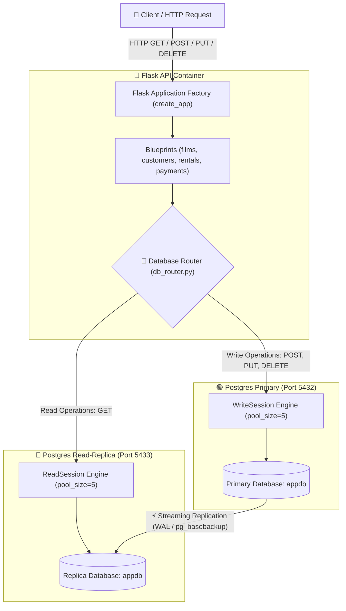

# 🎬 Pagila Movie Rental REST API & Read/Write Replication Stack

[](https://www.python.org/)
[](https://flask.palletsprojects.com/)
[](https://www.postgresql.org/)
[](https://www.sqlalchemy.org/)
[](https://www.docker.com/)
[](https://docs.pytest.org/)

A enterprise-grade, high-performance RESTful API built with **Flask (App Factory Pattern)** and **SQLAlchemy ORM** mapped to the industry-standard **Pagila** (PostgreSQL DVD rental benchmark) dataset of over **40,000+ records**.

This architecture features dynamic **Read/Write DB Splitting** using **PostgreSQL Primary/Replica Physical Streaming Replication**, containerized with **Docker Compose**, optimized with custom B-tree indexing, and verified via **Pytest**.

---

## 📐 System Architecture



---

## ✨ Key Features

- 🏗️ **Flask Application Factory Pattern**: Modular Blueprint architecture (`films`, `customers`, `rentals`, `payments`, `health`).
- 🔀 **Smart Database Read/Write Splitting**:
  - **Write Queries (POST / PUT / DELETE)**: Dispatched directly to the **Primary PostgreSQL** instance.
  - **Read Queries (GET)**: Distributed to the **Read-Replica PostgreSQL** node to maximize throughput and prevent lock contention.
- 🗄️ **Comprehensive Pagila ORM Mapping**: 15+ fully defined SQLAlchemy models including complex many-to-many relationships (Films, Actors, Categories, Rentals, Payments, Customers, Inventory).
- 🐳 **Complete Containerization**: Docker Compose stack orchestrating Flask API, Primary Postgres DB, and Replica Postgres DB.
- ⚡ **Database Optimization**: Custom indexing (`idx_api_rental_customer_id`) yielding **sub-3ms query execution times** on high-frequency lookups.
- 🩺 **Health & Readiness Endpoints**: Enterprise `/healthz` (liveness) and `/readyz` (readiness with active DB ping) routes.
- 🧪 **Automated Testing Suite**: 100% suite pass rate with Pytest for endpoint validation and database routing integrity.

---

## 📁 Repository Structure

```
Project - Flask/
├── 1__pagila-schema.sql         # Pagila database schema definition
├── 2__pagila-insert-data.sql      # Pagila dataset insert script (40,000+ records)
├── README.md                    # Project documentation
└── flask-app/
    ├── app/
    │   ├── __init__.py          # Flask App Factory initialization & blueprint setup
    │   ├── config.py            # Environment-driven configuration loader
    │   ├── models/
    │   │   └── db.py            # SQLAlchemy database models & schemas
    │   ├── routes/              # Modular API Blueprints
    │   │   ├── health.py        # Health & readiness checks (/healthz, /readyz)
    │   │   ├── films.py         # Film catalog endpoints (/api/films)
    │   │   ├── customers.py     # Customer management endpoints (/api/customers)
    │   │   ├── rentals.py       # Rental transaction routes (/api/rentals)
    │   │   └── payments.py      # Payment transaction routes (/api/payments)
    │   └── services/
    │       └── db_router.py     # ReadSession & WriteSession connection router
    ├── scripts/
    │   └── setup_replication.sh # Physical replication setup & streaming script
    ├── tests/
    │   └── test_routes.py       # Pytest integration & endpoint test suite
    ├── Dockerfile               # Container spec for Flask API app
    ├── docker-compose.yml       # Multi-container service orchestration
    ├── requirements.txt         # Python package dependencies
    └── wsgi.py                  # WSGI application entry point
```

---

## 🚀 Quick Start Guide

### Prerequisites

Ensure you have the following installed on your machine:
- 🐳 [Docker Desktop](https://www.docker.com/products/docker-desktop/) (running)
- 🐚 **Bash Environment** (WSL2 / Git Bash on Windows, Terminal on Linux/macOS)

---

### Step 1: Start Container Infrastructure

From the root directory, navigate into `flask-app` and launch the Docker stack:

```bash
cd flask-app
docker compose up -d --build
```

*This spins up the Flask API container alongside empty PostgreSQL Primary and Replica services.*

---

### Step 2: Seed Schema, Load Data & Establish Streaming Replication

Return to the repository root and run the replication setup script:

```bash
cd ..
bash flask-app/scripts/setup_replication.sh
```

#### What `setup_replication.sh` executes:
1. Creates the `replicator` database role with replication permissions on the Primary node.
2. Injects Pagila schema (`1__pagila-schema.sql`) and sample data (`2__pagila-insert-data.sql`).
3. Executes `pg_basebackup` to clone the Primary database state onto the Replica node.
4. Synchronizes replication streams and verifies row counts across both instances.

---

## 🌐 API Reference & Database Routing

### 🩺 System & Health Endpoints

| Method | Endpoint | Description | Targeted DB |
| :--- | :--- | :--- | :--- |
| `GET` | `/healthz` | Web application liveness check | None (N/A) |
| `GET` | `/readyz` | Database connectivity readiness probe | Read Replica |

---

### 🎬 Films API (`/api/films`)

| Method | Endpoint | Query / Body Params | Description | Target DB |
| :--- | :--- | :--- | :--- | :--- |
| `GET` | `/api/films/` | `?category=Action` | List top 50 films (optional category filter) | Read Replica |
| `GET` | `/api/films/<id>` | — | Get film details with actors & categories | Read Replica |
| `POST` | `/api/films/` | `{ "title": "..." }` | Create a new film entry | Primary DB |
| `PUT` | `/api/films/<id>` | `{ "rental_rate": 3.99 }` | Update film details | Primary DB |
| `DELETE` | `/api/films/<id>` | — | Delete a film record | Primary DB |

#### Example: Fetch Film Details (`GET /api/films/1`)
```json
{
  "film_id": 1,
  "title": "ACADEMY ADAPTATION",
  "description": "A Epic Drama of a Feminist And a Mad Scientist who must Battle a Teacher in The Canadian Rockies",
  "categories": ["Documentary"],
  "actors": [
    { "first_name": "PENELOPE", "last_name": "GUINESS" },
    { "first_name": "CHRISTIAN", "last_name": "GABLE" }
  ]
}
```

---

### 👤 Customers API (`/api/customers`)

| Method | Endpoint | Description | Target DB |
| :--- | :--- | :--- | :--- |
| `GET` | `/api/customers/` | List active customers | Read Replica |
| `GET` | `/api/customers/<id>` | Get customer profile & address | Read Replica |
| `POST` | `/api/customers/` | Register a new customer | Primary DB |
| `PUT` | `/api/customers/<id>` | Update customer email/status | Primary DB |

---

### 📦 Rentals & Payments API (`/api/rentals` & `/api/payments`)

| Method | Endpoint | Description | Target DB |
| :--- | :--- | :--- | :--- |
| `GET` | `/api/rentals/` | List rentals (`?customer_id=1`) | Read Replica |
| `POST` | `/api/rentals/` | Create new film rental record | Primary DB |
| `PUT` | `/api/rentals/<id>/return` | Mark rental as returned | Primary DB |
| `GET` | `/api/payments/` | List payments (`?customer_id=1`) | Read Replica |
| `POST` | `/api/payments/` | Record customer payment | Primary DB |

---

## 📊 Database Performance & Optimization

To ensure optimal execution under heavy workloads, key indexes were created on high-frequency query targets like `rental(customer_id)`.

### Benchmark Results (`EXPLAIN ANALYZE`)

```sql
EXPLAIN ANALYZE SELECT * FROM rental WHERE customer_id = 1;
```

#### Query Execution Plan:
```text
Bitmap Heap Scan on rental  (cost=4.53..82.68 rows=32 width=36) (actual time=1.099..1.347 rows=32 loops=1)
   Recheck Cond: (customer_id = 1)
   Heap Blocks: exact=28
   ->  Bitmap Index Scan on idx_api_rental_customer_id  (cost=0.00..4.53 rows=32 width=0) (actual time=1.039..1.066 rows=32 loops=1)
         Index Cond: (customer_id = 1)
 Planning Time: 6.116 ms
 Execution Time: 2.834 ms
```

> ⚡ **Execution Time**: ~2.83 ms via `Bitmap Index Scan` on `idx_api_rental_customer_id`.

---

## 🛠️ Direct Database Inspection

You can connect directly to both database nodes using any GUI client (**DBeaver**, **pgAdmin 4**, **TablePlus**):

| Setting | Primary Database Node | Read-Replica Node |
| :--- | :--- | :--- |
| **Host** | `localhost` | `localhost` |
| **Port** | `5432` | `5433` |
| **Database** | `appdb` | `appdb` |
| **Username** | `postgres` | `postgres` |
| **Password** | `studentpass` | `studentpass` |

---

## 🧪 Running Automated Tests

Run the full integration test suite inside the container environment:

```bash
docker exec -it flask-app pytest -v
```

### Expected Output:
```text
============================= test session starts ==============================
platform linux -- Python 3.11.15, pytest-9.1.0
collected 8 items

tests/test_routes.py::test_healthz_returns_ok PASSED                     [ 12%]
tests/test_routes.py::test_get_films_returns_200 PASSED                  [ 25%]
tests/test_routes.py::test_create_film_returns_201 PASSED                [ 37%]
tests/test_routes.py::test_get_film_not_found_returns_404 PASSED         [ 50%]
tests/test_routes.py::test_get_customers_returns_200 PASSED              [ 62%]
tests/test_routes.py::test_create_customer_returns_201 PASSED            [ 75%]
tests/test_routes.py::test_create_rental_returns_201 PASSED              [ 87%]
tests/test_routes.py::test_return_rental_updates_return_date PASSED      [100%]

============================== 8 passed in 1.77s ===============================
```

---

## 📜 License

This project is open-source and available under the [MIT License](LICENSE).

